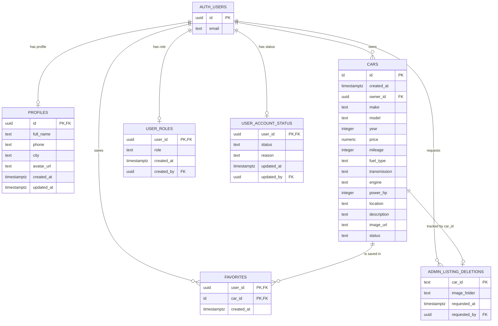

# AutoMarket

AutoMarket is a responsive online car marketplace developed as a capstone project for the SoftUni **Software Technologies with AI** course. It allows visitors to browse approved vehicle listings, while registered users can publish and manage cars, save favorites, maintain a seller profile, upload images, and contact sellers. A protected administration dashboard provides listing moderation and account management.

- **Live application:** [automarket-miro.netlify.app](https://automarket-miro.netlify.app)
- **Source code:** [github.com/miro00-dev/automarket](https://github.com/miro00-dev/automarket)

## Features

### Public marketplace

- Responsive home page with featured vehicles, popular makes, benefits, and search controls.
- Browse Cars page with make, model, price, fuel, and year filters.
- Active listings loaded from Supabase, with local demo data used only as a connectivity fallback.
- Vehicle details page with a responsive image gallery and technical information.
- Seller contact section showing the public seller name, city, profile picture, and phone controls.
- Friendly loading, empty, not-found, and error states.

### Authentication and accounts

- Email and password registration and login through Supabase Auth.
- Persistent authenticated sessions and logout functionality.
- Password recovery email and secure new-password page.
- Protected pages redirect unauthenticated users to Login and return them afterward.
- Responsive My Profile page for full name, phone, city, and profile picture.

### Listings

- Authenticated users can create vehicle listings with structured validation.
- Multiple JPG, PNG, or WebP vehicle images, with the first image used as the cover.
- My Listings displays only the current user's vehicles.
- Owners can edit and delete their own listings.
- Edited and newly submitted listings support the moderation statuses `pending`, `active`, and `rejected`.
- Marketplace visitors see active listings only.

### Favorites

- Authenticated users can add and remove cars with the heart control.
- Favorite state is synchronized with Supabase.
- The Favorites page contains only the current user's saved vehicles.
- Logged-out visitors are returned to the originating page after login.

### Administration

- Admin navigation and dashboard are available only to active users with the `admin` role.
- Dashboard statistics for total users, total listings, pending listings, and approved listings.
- Paginated user and listing tables.
- Approve or reject listings.
- Robust listing and Storage image deletion workflow.
- Suspend and reactivate non-admin accounts, with an optional bounded suspension reason.
- Server-side authorization through PostgreSQL `SECURITY DEFINER` RPC functions, restricted grants, and RLS—not frontend role checks alone.
- Admin accounts cannot suspend themselves or other administrators through the public RPC.

## Technology stack

| Area | Technology |
| --- | --- |
| Build tool | Vite 8 |
| Frontend | HTML5, CSS3, Vanilla JavaScript (ES modules) |
| UI | Bootstrap 5, Bootstrap Icons |
| Runtime and packages | Node.js, npm |
| Backend as a service | Supabase |
| Database | PostgreSQL with Row Level Security |
| Authentication | Supabase Auth |
| File storage | Supabase Storage |
| Hosting | Netlify |

The project intentionally does **not** use React, Vue, TypeScript, or another frontend framework.

## Architecture

AutoMarket is a true multi-page application. Vite receives every HTML page as an explicit Rollup input and produces a standalone production entry for each route.

```text
HTML pages
   │
   ▼
src/main.js
   ├── shared header/footer and authentication navigation
   ├── page initializer selected by the page DOM
   ├── reusable car and favorites components
   └── service modules
          │
          ▼
     Supabase JavaScript client
          ├── PostgreSQL tables, views, RLS and RPC functions
          ├── Supabase Auth
          └── Supabase Storage
```

The main layers are:

- `pages/`: MPA HTML documents.
- `src/pages/`: page initialization, rendering, validation, and event handling.
- `src/components/`: reusable navigation, footer, car card, and favorite controls.
- `src/services/`: all Supabase queries, RPC calls, Auth operations, and Storage operations.
- `src/utils/`: mapping, formatting, image, and safe HTML helpers.
- `src/styles/`: shared responsive design system.
- SQL migrations: schema, grants, RLS, Storage policies, secure views, and admin RPCs.

## Database schema

Supabase Auth owns `auth.users`. Application data lives in the `public` schema and is protected with grants and Row Level Security.



### Database objects

- `public.cars`: marketplace listing data. `owner_id` links a listing to `auth.users`; `status` controls public visibility and moderation.
- `public.profiles`: owner-only editable profile fields.
- `public.favorites`: composite-key join table between users and cars.
- `public.user_roles`: restricted role assignment table; the current schema permits the `admin` role.
- `public.user_account_status`: `active` or `suspended` account state and optional reason.
- `public.admin_listing_deletions`: retryable marker used to coordinate listing and Storage cleanup safely. `car_id` intentionally mirrors a listing ID as text and is not declared as a foreign key.
- `public.seller_profiles`: read-only, security-barrier view exposing only `id`, `full_name`, `phone`, `city`, and `avatar_url` for sellers with active listings.

The repository extends a pre-existing `public.cars` table; its original creation migration is not included. The fields shown above are the columns selected and written by the current application code and SQL migrations. The favorites migration detects the deployed `cars.id` type dynamically.

### Storage

- `car-images`: public vehicle images stored under `<user-id>/<listing-folder>/<file>`. Writes are restricted to the authenticated owner's folder.
- `profile-pictures`: public profile images stored under `<user-id>/<file>`, with JPG, PNG, and WebP support and a 5 MB bucket limit.

Only public URLs are stored in application tables. The `cars.image_url` value is the cover image; the remaining gallery images are discovered from its Storage folder.

## Project structure

```text
automarket/
├── index.html                         # Home page
├── pages/
│   ├── cars.html                      # Browse Cars
│   ├── car-details.html               # Vehicle details and seller contact
│   ├── add-car.html                   # Create/edit listing
│   ├── my-listings.html               # Current user's listings
│   ├── favorites.html                 # Saved vehicles
│   ├── profile.html                   # User profile
│   ├── login.html                     # Login
│   ├── register.html                  # Registration
│   ├── forgot-password.html           # Request recovery email
│   ├── update-password.html           # Set a new password
│   └── admin.html                     # Protected admin dashboard
├── src/
│   ├── assets/                        # Local static assets
│   ├── components/                    # Shared UI modules
│   ├── data/                          # Demo fallback vehicle data
│   ├── pages/                         # Page controllers
│   ├── services/                      # Supabase/Auth/Storage access
│   ├── styles/                        # Shared CSS
│   ├── utils/                         # Mapping, formatting and safety helpers
│   └── main.js                        # Shared application entry
├── public/_redirects                  # Netlify routing rules
├── supabase-*.sql                     # Reviewed manual Supabase migrations
├── vite.config.js                     # Multi-page build inputs
├── .env.example                       # Public environment variable template
└── package.json
```

## Local development

### Prerequisites

- Node.js and npm
- A Supabase project with the required schema and Storage buckets

### Installation

```bash
git clone https://github.com/miro00-dev/automarket.git
cd automarket
npm install
```

Copy the environment template:

```bash
cp .env.example .env
```

On Windows PowerShell:

```powershell
Copy-Item .env.example .env
```

Fill in only the public browser configuration:

```env
VITE_SUPABASE_URL=https://your-project-ref.supabase.co
VITE_SUPABASE_PUBLISHABLE_KEY=sb_publishable_your_public_key
```

Start the development server:

```bash
npm run dev
```

Create a production build:

```bash
npm run build
```

Preview the build locally:

```bash
npm run preview
```

## Supabase configuration

### API values

Find the public project URL and publishable key in the Supabase Dashboard under **Project Settings → API**. Depending on the Dashboard version, the publishable key can also appear under **Connect**.

Never put a `service_role` key, database password, or another secret in `.env` or frontend code. Vite variables prefixed with `VITE_` are included in the browser bundle.

### Auth URL configuration

In **Authentication → URL Configuration**, use:

```text
Site URL: https://automarket-miro.netlify.app
Password recovery redirect:
https://automarket-miro.netlify.app/pages/update-password.html
```

Add an appropriate localhost redirect while testing locally. The production recovery URL must be present in the allowed Redirect URLs list. Production email delivery should use a configured SMTP provider rather than relying on the limited default mail service.

### Database and RLS migrations

All SQL files are intended for manual review and execution in the Supabase SQL Editor. They must not contain credentials.

Core application setup files:

1. `supabase-owner-setup.sql` — connects listings to Auth users and adds owner/Storage RLS.
2. `supabase-favorites-setup.sql` — creates favorites and owner-only policies.
3. `supabase-profiles-setup.sql` — creates profiles and the `profile-pictures` bucket policies.
4. `supabase-profile-permissions-fix.sql` — narrow profile grants needed by the current upsert flow.
5. `supabase-seller-setup.sql` — restricted public seller interface.
6. `supabase-admin-setup.sql` — roles, account status, moderation RPCs, suspension rules, and admin Storage policies.

Before applying these scripts, create/configure the `car-images` public bucket and ensure the existing `cars` table contains the columns documented above. Review existing policies before applying new ones because permissive PostgreSQL policies combine with OR semantics.

The following files are targeted repair/verification migrations for an already deployed database and are **not** a normal clean-install sequence:

- `supabase-admin-hosted-auth-gateway-fix.sql`
- `supabase-admin-auth-permissions-fix.sql`
- `supabase-admin-deployed-ownership-check.sql`

Use only the repair that matches the deployed function ownership state. Do not repeatedly run the full admin setup against an existing deployment without reviewing function ownership and dependencies.

### Assigning the first administrator

Administrator assignment is intentionally a manual SQL Editor operation. The reviewed block at the end of `supabase-admin-setup.sql` validates that exactly one Auth account matches before inserting `role = 'admin'`. Never expose role assignment through the browser application.

## Security model

- RLS limits users to their own profiles, favorites, listings, and Storage folders.
- Public marketplace reads are restricted to active listings.
- Seller contact data is exposed through a narrow view rather than direct public profile access.
- Admin RPCs independently verify both the admin role and active account status.
- Privileged functions use `SECURITY DEFINER`, empty `search_path` settings, fully qualified objects, and narrow `EXECUTE` grants.
- Suspended accounts can authenticate and read public marketplace content but cannot mutate protected AutoMarket data.
- Client code uses only the public Supabase publishable key.
- Password reset responses do not reveal whether an email address is registered.

## Deployment

Netlify builds the project with:

```text
Build command: npm run build
Publish directory: dist
```

The committed `public/_redirects` file is copied to `dist/_redirects`. It maps `/admin` to the real Admin HTML page and provides a fallback for direct navigation. Environment variables must be configured in the Netlify site settings.

## Author

Developed by [miro00-dev](https://github.com/miro00-dev) as a SoftUni capstone project.
